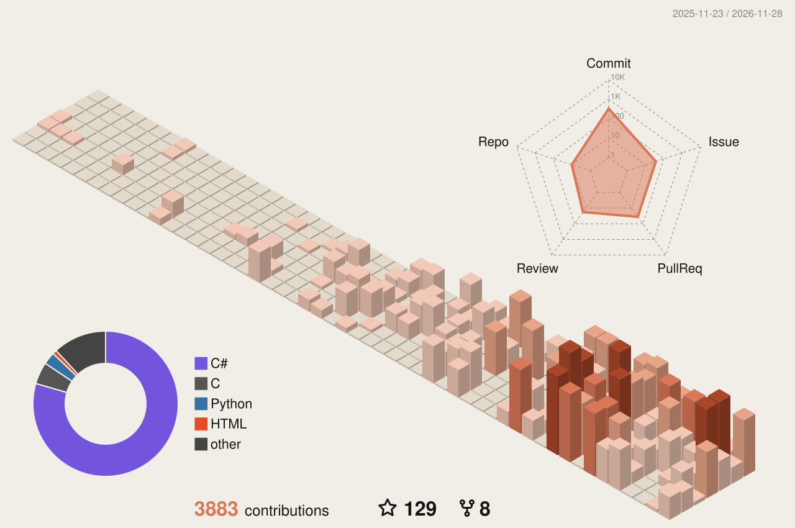

<!-- 配色：Surface #30302E · Ivory #F0EEE6 · Clay #D97757 · Ink #141413 · Slate #3D3D3A -->

  <picture>
    <source media="(prefers-color-scheme: dark)" srcset="./assets/banner-dark.svg" />
    
  </picture>

  

<h2 align="center">关于我 · About Me</h2>

  

  你好，我是 <b>苏幽璃</b>，很高兴认识你～ 
  喜欢尝试新奇的技术，也喜欢捣鼓各种有趣的项目。 
  成分比较复杂；最近在给《杀戮尖塔 2》写模拟器和 AI。 
  <i>无法飞翔的翅膀，也有它存在的意义。</i>

<h2 align="center">正在做 · Projects</h2>

| 项目 | 简介 | Stars |
| :-- | :-- | :-: |
| [**sts2-sim**](https://github.com/iRyougi/sts2-sim) | 《杀戮尖塔 2》非官方 headless 模拟器，随机数与种子与游戏一致 |  |
| [**WutheringWavesSteamHelper**](https://github.com/iRyougi/WutheringWavesSteamHelper) | 从 Steam 快捷启动已上线 Steam 的游戏国服 |  |
| [**SaveandLoad2-Public**](https://github.com/iRyougi/SaveandLoad2-Public) | 杀戮尖塔 2 存档解析软件 |  |
| [**sts2-swordart**](https://github.com/iRyougi/sts2-swordart) | 锻刀大赛：统计锻造峰值与伤害的 STS2 mod，附多人排行榜 |  |

<h2 align="center">贡献城市 · Contributions</h2>

  

<h2 align="center">技术栈 · Stack</h2>

  
  
  
  
  
  

  
  
  
  
  
  

<h2 align="center">联系我 · Contact</h2>

  
  
  
  

  <picture>
    <source media="(prefers-color-scheme: dark)" srcset="https://raw.githubusercontent.com/iRyougi/iRyougi/output/snake-dark.svg" />
    
  </picture>

  

